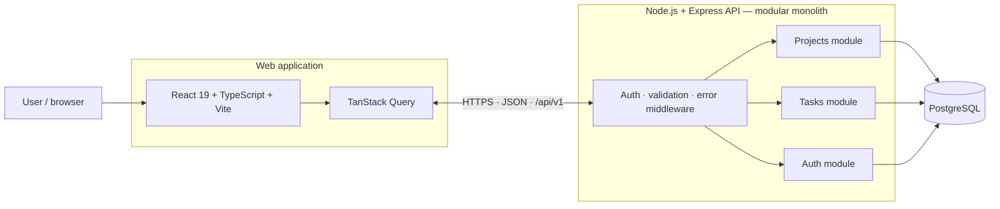
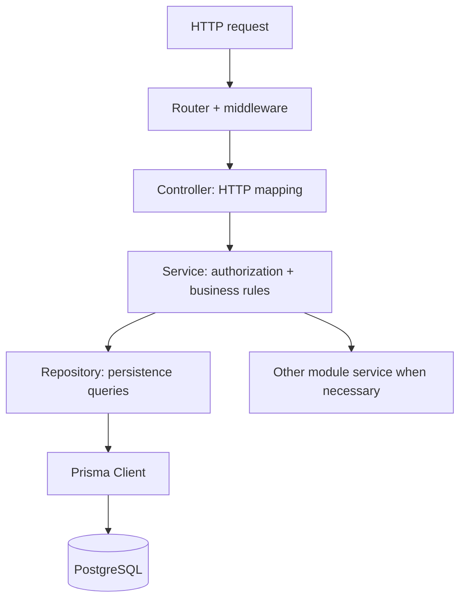
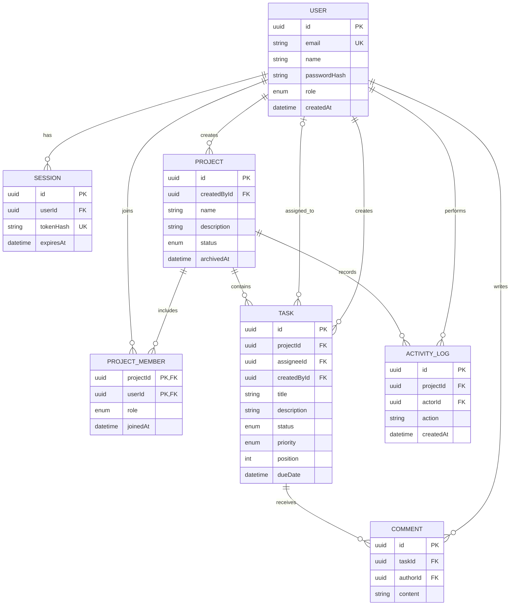
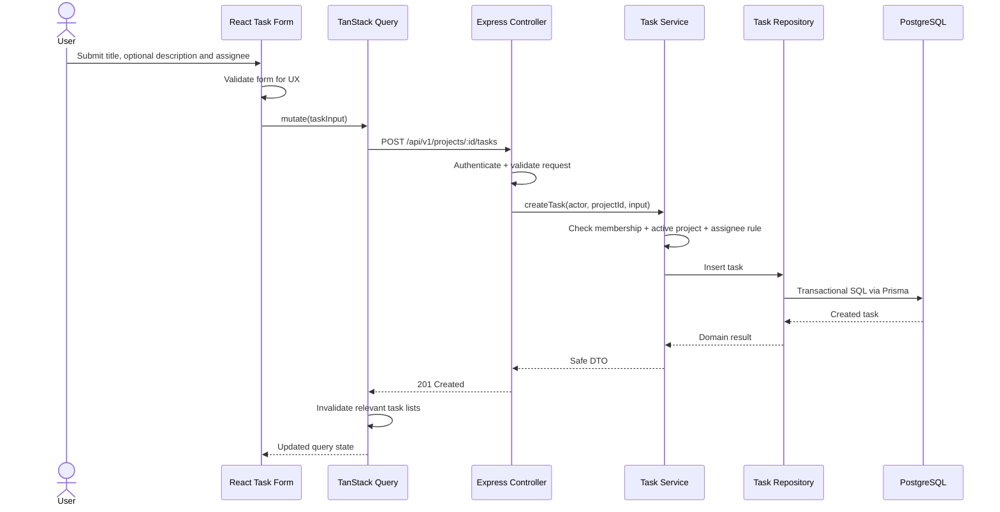
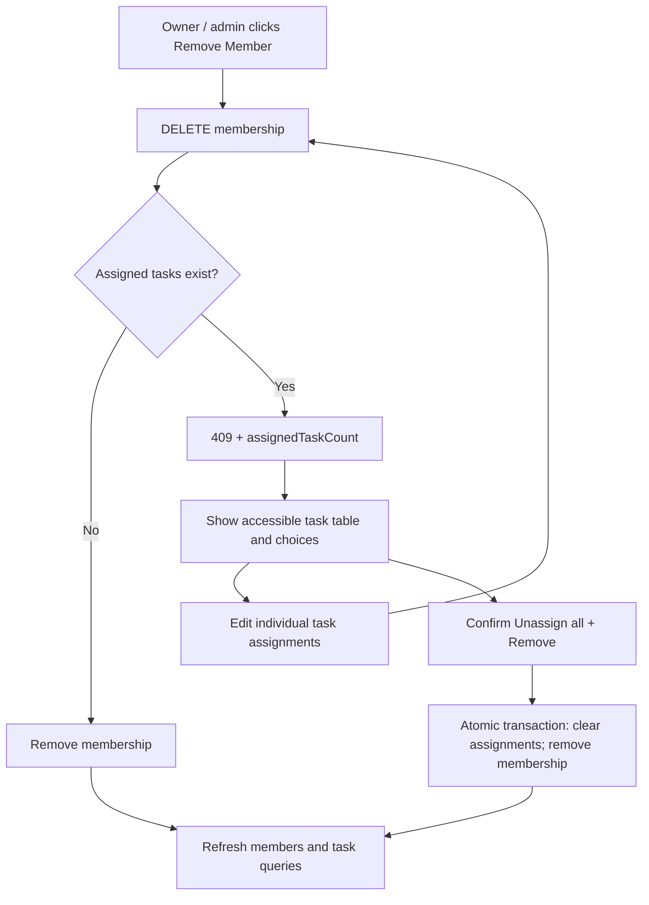

# Project Management Platform — System Architecture & Data Model

**Version:** 0.2  
**Status:** Proposed — updated with M0.2 review feedback  
**Milestone:** M0.2 – System Architecture & Data Model  
**Branch:** `docs/0007-product-discovery`  
**Related document:** `docs/product/requirements.md`

> This document specifies the target architecture for the MVP and planned V1 extensions. It is a design baseline, not a statement that the system has already been implemented. Decisions can change through a documented architecture decision record (ADR).

## Viewing diagrams in VS Code

The diagrams below use standard fenced Mermaid code blocks with the language identifier `mermaid`. In a recent VS Code release, open **Markdown: Open Preview to the Side** (`⌘K V` on macOS) and ensure the built-in **Mermaid Markdown Features** extension is enabled. Older VS Code versions require updating VS Code or enabling a Mermaid Markdown preview extension. If you only see Mermaid source text, that indicates a preview-renderer issue rather than missing diagram data. See the [VS Code Markdown documentation](https://code.visualstudio.com/docs/languages/markdown).

## 1. Architecture goals and constraints

- Build a small-team, **single-organization** project management system (not multi-tenant).
- Maintain a single Git repository with independently runnable React and Node.js applications.
- Favor a **modular monolith** for the backend: one API deployment with modules organized around business capabilities.
- Enforce authorization and domain invariants **on the backend**, not only in the UI.
- Use an explicit, testable request → controller → service → repository → database flow, but avoid unnecessary wrappers for trivial logic.
- Reuse public API request/response contracts without sharing database entities or sensitive fields with the frontend.
- Deliver the MVP first and add comments, audit history, user settings, and user administration in V1. Project-level `PROJECT_OWNER` handles day-to-day project administration in the MVP.

## 2. System context and deployment boundaries



**Development:** Vite runs on `localhost:5173` and proxies `/api` to Express on `localhost:3001`. `GET /api/health` remains the infrastructure health route.

**Production concept:** Browser → HTTPS frontend/reverse proxy → `/api/v1` on Express → private PostgreSQL. The development proxy is not the production deployment architecture. Exact hosting will be selected at M10.

## 3. Architecture style and module boundaries

### 3.1 Backend: feature-first modular monolith

One Express process hosts separate feature modules. Typical business modules:

| Module | Responsibilities | MVP / V1 |
|---|---|---|
| `auth` | Login, logout, current user, sessions, password verification | MVP |
| `users` | User lookup; user administration UI/API added later | MVP support / V1 admin |
| `projects` | Create, list, update, archive projects | MVP |
| `project-members` | Add/remove members, manage project ownership, enforce membership consistency | MVP |
| `tasks` | Task CRUD, assignments, filters, board ordering | MVP |
| `dashboard` | Authorized summaries and aggregate queries | MVP |
| `comments` | Comments on tasks | V1 |
| `activity` | Immutable audit events for significant changes | V1 |
| `settings` | Profile settings | V1 |

**Dependency rule:** routes/controllers depend on services; services depend on repository interfaces or narrowly scoped repository implementations; repositories access Prisma. The database and HTTP framework must not determine business rules. Shared infrastructure is allowed, but feature modules must not directly edit another module's database entities through arbitrary cross-module imports.



**Pragmatism:** not every GET endpoint needs an elaborate interface hierarchy. Start with concrete, injectable services and small repository functions; introduce abstractions where they improve testing, separation or changeability.

### 3.2 Frontend: feature-based React application

- `app/`: composition root, router, providers, global styles.
- `features/auth/`, `features/projects/`, `features/tasks/`, `features/dashboard/`: feature routes, components, API clients, hooks and styles.
- `shared/ui/`: accessible reusable presentation components without business-specific logic.
- `shared/lib/`: generic utilities, HTTP client configuration, formatting and error helpers.
- `packages/contracts/`: **public API DTOs and schemas only**, shared between web and API; no Prisma types, password hashes or session secrets.

**State ownership policy:**

| State category | Preferred tool | Examples / rationale |
|---|---|---|
| Local UI state | `useState` | Open/closed dialog, selected tab |
| Complex local transitions | `useReducer` | Multi-step form or a coordinated local workflow |
| Low-frequency app-wide UI configuration | `useContext` | Theme / visual preferences |
| Server state | TanStack Query | Project and task lists, `/auth/me`, caching and invalidation |
| Cross-feature client-only state | Zustand **if justified** | Complex Kanban interaction or persistent UI preferences when local state becomes awkward |
| Derived render data | Plain calculation first | `useMemo` only after a real cost or reference stability requirement |
| Callbacks | Plain functions first | `useCallback` only where reference stability measurably matters |

**Never** duplicate server-owned projects/tasks as a second mutable source of truth in Zustand by default.

### 3.3 Proposed future repository layout

```text
project-management-app/
├── apps/
│   ├── web/
│   │   └── src/
│   │       ├── app/                 # router, providers, global CSS
│   │       ├── features/
│   │       │   ├── auth/
│   │       │   ├── projects/
│   │       │   ├── tasks/
│   │       │   └── dashboard/
│   │       └── shared/              # ui, lib
│   └── api/
│       ├── prisma/                  # schema, migrations, seed
│       └── src/
│           ├── app/                 # Express assembly and middleware
│           ├── modules/
│           │   ├── auth/
│           │   ├── projects/
│           │   ├── project-members/
│           │   ├── tasks/
│           │   └── dashboard/
│           └── shared/              # db, errors, auth utilities
├── packages/
│   └── contracts/                   # client-safe Zod schemas + DTO types
├── docs/
│   ├── product/requirements.md
│   └── architecture/
│       ├── system-design.md
│       └── adr/
├── package.json
└── pnpm-workspace.yaml
```

This is a **target layout**. It will be introduced incrementally, not generated as empty folders now.

## 4. Identity, authorization and business invariants

### 4.1 Global and project-level roles

Two independent authorization dimensions avoid granting organization-wide powers to a project manager:

- **Global `User.role`:** `ADMIN` or `MEMBER`. `ADMIN` manages organization-wide user accounts and can administer any project. A `MEMBER` may create a project, but has no administrative rights over unrelated projects.
- **Project membership `ProjectMember.role`:** `PROJECT_OWNER` or `MEMBER`. `PROJECT_OWNER` is **scoped to exactly one project membership**, not a global role. The same user can own Project A and be an ordinary member of Project B.
- Any authenticated user can create a project and is atomically added to it as its first `PROJECT_OWNER`. An `ADMIN` can also create projects, without becoming a required day-to-day operator. This is an explicit product decision for self-service project creation.
- `PROJECT_OWNER` can edit/archive their active project, manage its members and project ownership, create/update/delete its tasks, and view all project tasks. This does not grant permission on other projects.
- Project `MEMBER` can view all tasks of their projects and create/update tasks there, but cannot delete tasks or manage membership.
- `ADMIN` can oversee any project and perform project-owner operations globally. Project-specific ownership is still recorded as membership for ordinary project participants.
- A project must retain **at least one `PROJECT_OWNER`** while active. The final owner cannot be removed or demoted until another project member becomes an owner; owners may promote another existing member.
- A task assignee must be a member of its project, including for assignments made by admins or owners (BR-04).
- Archived projects are **read-only for every role**, including `ADMIN` and `PROJECT_OWNER`: no edits, task changes, membership updates, reordering or bulk unassignment (BR-09). Unarchiving is outside the initial scope.

**Authorization sequence:** authenticate user → check global role or project membership → check permitted action → enforce active-project and entity-specific business rules. Backend authorization and database-scoped reads are always mandatory.

### 4.2 Project member removal with assigned tasks

When a `PROJECT_OWNER` or `ADMIN` attempts to remove a member:

1. The backend checks project permissions, project status, last-owner protection, and the assignee's outstanding task assignments.
2. If the user has assigned tasks, ordinary `DELETE /api/v1/projects/:projectId/members/:userId` returns `409 MEMBER_HAS_ASSIGNED_TASKS` and a safe `assignedTaskCount` value, without making any changes.
3. The frontend displays a confirmation dialog with an accessible, paginated table of affected tasks, retrieved via `GET /api/v1/projects/:projectId/members/:userId/assigned-tasks`. Each row links to the task editor so tasks can be reassigned individually.
4. The dialog also offers **Unassign all tasks and remove member**. After explicit confirmation, `POST /api/v1/projects/:projectId/members/:userId/remove` with `{ "resolution": "UNASSIGN_ALL" }` performs both operations **atomically**: set those tasks' `assigneeId` to `null`, then delete project membership. If any step fails, the transaction rolls back.
5. The API rechecks permissions, active status, assigned tasks, and last-owner protection **inside the transaction**, and coordinates concurrent assignment/removal writes to prevent invalid references.

**UX/accessibility:** show task `title`, `status`, `priority` and a link to each task; show total count; use keyboard-operable controls, clear impact warning, focus management and explicit confirmation. Never bulk-remove tasks silently. The user is not deleting tasks; only the assignee is cleared.

### 4.3 Authentication design

- Server-managed, opaque sessions (not JWTs in localStorage).
- On login, verify an Argon2id password hash, generate a high-entropy random session token, store **only a hash of that token** in PostgreSQL and send the raw token in an `HttpOnly` cookie.
- Session cookie: `HttpOnly`, `Secure` in HTTPS production, explicit `SameSite=Lax`, `Path=/` and a deliberate expiry policy.
- Lookup by hashed token and session expiry; logout invalidates server-side session and clears cookie.
- Enforce Origin checks / appropriate CSRF protection for state-changing cookie-authenticated requests, in addition to SameSite and CORS restrictions.
- Never store session tokens in logs or expose password hashes in API responses.
- MVP accounts are **seeded for local development** (including ADMIN and MEMBER); self-registration is out of scope, and user management UI arrives in V1.

## 5. Data model

### 5.1 Entity relationship diagram

The entity diagram includes **`Task.description`** (nullable) and the **project-scoped `ProjectMember.role`**. A global user role is not the same thing as project ownership.



`Task.description` is **optional (nullable text)** and may be blank. The assignee reference is also optional; after bulk unassignment it is set to `null`. `COMMENT` and `ACTIVITY_LOG` are V1 extensions shown for forward planning.

### 5.2 Entity definitions

| Entity | Core fields and rules | Phase |
|---|---|---|
| `User` | `id`, normalized unique `email`, `name`, `passwordHash`, global `role`, timestamps | MVP |
| `Session` | `id`, `userId`, unique `tokenHash`, `expiresAt`, timestamps | MVP |
| `Project` | `id`, `name`, optional `description`, `status ACTIVE\|ARCHIVED`, `createdById`, `archivedAt`, timestamps | MVP |
| `ProjectMember` | composite key `(projectId, userId)`, `role = PROJECT_OWNER\|MEMBER`, `joinedAt`; unique membership and at least one owner per active project | MVP |
| `Task` | `id`, `projectId`, `createdById`, nullable `assigneeId`, `title`, nullable text `description`, `status`, `priority`, optional `dueDate`, `position`, timestamps | MVP |
| `Comment` | `id`, `taskId`, `authorId`, `content`, timestamps | V1 |
| `ActivityLog` | `id`, `projectId`, `actorId`, `action`, optional metadata, `createdAt` | V1 |

**Enums:**
- Global user role: `ADMIN`, `MEMBER`.
- Per-project membership role: `PROJECT_OWNER`, `MEMBER`.
- Project status: `ACTIVE`, `ARCHIVED`.
- Task status: `TODO`, `IN_PROGRESS`, `IN_REVIEW`, `DONE` (BR-05).
- Task priority: `LOW`, `MEDIUM`, `HIGH`, `URGENT` (BR-06).

**Index candidates:** `User(email)` unique; `Session(tokenHash)` unique and `expiresAt`; `ProjectMember(projectId,userId)` primary key plus `(projectId,role)` for owner checks; `Task(projectId,status,position)` for board; `Task(projectId,assigneeId)`; index/filter choices should be checked using actual queries, not added indiscriminately.

**Consistency:** foreign keys for user, project and task references; required fields enforced in the database; cross-row invariants such as assignee membership enforced transactionally in backend services. Project archives are soft state changes, not physical deletion. The last-owner rule and assignee-membership consistency require transactional service checks, not just foreign keys.

### 5.3 Kanban ordering strategy

For MVP, tasks within a project/status column have an integer `position`. On drag-and-drop, send the proposed status and ordering; the backend validates authorization and reorders affected column(s) in a transaction. This avoids prematurely introducing fractional rank/CRDT complexity. Multiple-user simultaneous editing is not real-time; concurrency behavior will be explicitly tested and upgraded if needed.

## 6. REST API design

All business endpoints use `/api/v1`. `GET /api/health` remains outside the versioned business API.

### 6.1 MVP endpoints

| Method | Path | Responsibility | Access |
|---|---|---|---|
| `POST` | `/api/v1/auth/login` | Start session | Public |
| `POST` | `/api/v1/auth/logout` | Invalidate session | Authenticated |
| `GET` | `/api/v1/auth/me` | Current user | Authenticated |
| `GET` | `/api/v1/projects` | Visible projects, pagination | Authenticated, scoped |
| `POST` | `/api/v1/projects` | Create project + add first PROJECT_OWNER atomically | Authenticated |
| `GET` | `/api/v1/projects/:projectId` | Project details | ADMIN / project member |
| `PATCH` | `/api/v1/projects/:projectId` | Update active project | ADMIN / PROJECT_OWNER |
| `POST` | `/api/v1/projects/:projectId/archive` | Archive project | ADMIN / PROJECT_OWNER |
| `GET` | `/api/v1/projects/:projectId/members` | Members | ADMIN / project member |
| `POST` | `/api/v1/projects/:projectId/members` | Add member | ADMIN / PROJECT_OWNER |
| `PATCH` | `/api/v1/projects/:projectId/members/:userId/role` | Promote/demote project owner; preserve last owner | ADMIN / PROJECT_OWNER |
| `DELETE` | `/api/v1/projects/:projectId/members/:userId` | Remove member if no assigned tasks | ADMIN / PROJECT_OWNER |
| `GET` | `/api/v1/projects/:projectId/members/:userId/assigned-tasks` | Paginated assigned tasks preview | ADMIN / PROJECT_OWNER |
| `POST` | `/api/v1/projects/:projectId/members/:userId/remove` | Explicit bulk unassign + remove in one transaction | ADMIN / PROJECT_OWNER |
| `GET` | `/api/v1/projects/:projectId/tasks` | All project tasks (filters, paging, sorting) | ADMIN / project member |
| `POST` | `/api/v1/projects/:projectId/tasks` | Create task | ADMIN / project member |
| `GET` | `/api/v1/tasks/:taskId` | Task details including optional description | ADMIN / project member |
| `PATCH` | `/api/v1/tasks/:taskId` | Update task | ADMIN / project member |
| `DELETE` | `/api/v1/tasks/:taskId` | Delete task | ADMIN / PROJECT_OWNER |
| `PATCH` | `/api/v1/projects/:projectId/tasks/reorder` | Move/reorder tasks | ADMIN / project member |
| `GET` | `/api/v1/me/tasks` | My assigned tasks | Authenticated |
| `GET` | `/api/v1/dashboard/summary` | Accessible project/task aggregates | Authenticated, scoped |

All mutations targeting archived projects are rejected regardless of role. `GET` endpoints must always scope records at the **database query level**, not filter unauthorized rows after retrieval. `PROJECT_OWNER` rights apply only to that project.

### 6.2 V1 endpoints (planned)

- `GET/POST /api/v1/tasks/:taskId/comments` (project membership enforced).
- `GET /api/v1/projects/:projectId/activity`.
- `GET/PATCH /api/v1/users/me/settings`.
- `GET/POST/PATCH /api/v1/admin/users` (ADMIN only; exact account lifecycle TBD).

### 6.3 Request and response conventions

- JSON request/response bodies and conventional HTTP status codes.
- Resource IDs are UUIDs.
- List endpoints support bounded `page`, `pageSize` (e.g. max 100), and **allow-listed** sorting/filtering fields.
- Success examples: `200 OK` (read/update), `201 Created` (creation), `204 No Content` (successful deletion/logout).
- Error shape:

```json
{
  "error": {
    "code": "MEMBER_HAS_ASSIGNED_TASKS",
    "message": "This member has assigned tasks. Reassign them or confirm bulk unassignment before removal.",
    "details": { "assignedTaskCount": 7 }
  }
}
```

- Typical errors: `400` malformed request, `401` unauthenticated, `403` forbidden, `404` not found or intentionally concealed unauthorized resource, `409` business conflict, `422` structurally valid but invalid field values (pick consistent validation usage during implementation), `500` unexpected failure.
- The bulk-removal API accepts `{ "resolution": "UNASSIGN_ALL" }` only after explicit user confirmation; task contents are preserved and only `assigneeId` becomes `null`.
- The response from an assigned-tasks preview is paginated and contains only authorized task fields (`id`, `title`, `status`, `priority`, `assigneeId`), never unrelated private data.
- API DTOs are explicit; do not serialize database records directly.
- For paginated results: `{ "items": [...], "pagination": { "page": 1, "pageSize": 20, "total": 87 } }`.

## 7. Example: create task, end-to-end



**Task DTO example:** `{ "title": "Build project view", "description": "Implement responsive layout", "assigneeId": null }`. Description is optional.

**Security boundary:** the backend validates identity, permission, resource access, and business rules even when the form already validates them. To prevent time-of-check/time-of-use problems, dependent membership and task writes need a consistent transaction strategy.

## 8. Example: remove a member with assigned tasks



The last project owner cannot be removed or demoted. Archived projects cannot undergo any of these mutations. All authorization and consistency checks happen server-side and are rechecked transactionally for the bulk operation.

## 9. Testing, accessibility and operational constraints

- **Unit:** authorization policies and business rules (task assignment BR-04, member access, owner permissions, last-owner protection, archived read-only restriction).
- **Integration:** API routes with a real test database and deterministic seeds; project creation with owner membership, conflict `409`, preview task scoping, atomic bulk unassignment + membership removal, and rollback on failure.
- **E2E:** login → create project as MEMBER/initial PROJECT_OWNER → invite a member → create/assign tasks → try remove → review assigned-task table → bulk unassign + remove → verify tasks preserved without an assignee.
- **Frontend:** semantic table headers, accessible names/labels, keyboard navigation, visible focus, dialog focus management, clear destructive-action confirmation, adequate contrast and reduced-motion handling; Kanban drag/drop has keyboard fallback.
- **Security:** rate limiting on login, password hash verification, session expiry, input validation, authorization at every protected endpoint, CSRF defense for cookie-authenticated mutations.
- **Runtime:** structured error logging without credentials, graceful shutdown, health check, environment configuration outside version control.
- **Deployment:** Docker and CI/CD at M10; local Docker database can be added earlier when database work begins.

## 10. Architecture decisions to record (ADRs)

| ID | Decision | Why | Main trade-off |
|---|---|---|---|
| ADR-001 | Monorepo + pnpm workspace | Coordinated web/API changes and reusable contracts | Shared tooling requires care |
| ADR-002 | Modular monolith with Express | Simple deployment and clear business module boundaries | No independent per-module scaling |
| ADR-003 | PostgreSQL + Prisma | Relational constraints, transactions, TypeScript-friendly data access | ORM abstraction and migration discipline |
| ADR-004 | Server-managed cookie sessions | Revocable sessions without browser-stored bearer tokens | Session persistence and CSRF defense |
| ADR-005 | React Router + TanStack Query | Clear client navigation and server-state ownership | Extra libraries to learn |
| ADR-006 | CSS Modules + design tokens | Learn native CSS with scoped component styles | More hand-written styling than utility-first CSS |
| ADR-007 | API DTO/contracts separated from DB entities | Protect encapsulation and sensitive fields | Contract package needs build and version care |

These are **proposed** decisions until M0.2 is approved. Individual ADR files can be introduced at implementation milestones where detailed trade-offs matter.

## 11. Traceability: requirements → design → verification

| Requirement | Design mechanism | Verification example |
|---|---|---|
| FR-01 | `auth` module + `Session` table + cookie | Login/logout integration test |
| FR-03 / BR-01 / BR-10 | `projects` service + `ProjectMember.role` | Creating MEMBER becomes PROJECT_OWNER; other projects remain inaccessible |
| FR-04 / FR-14 / FR-15 / BR-04 / BR-11 / BR-12 | Project-scoped owner policy + transactional member removal | `409` shows assigned count; preview works; unassign+remove atomic; last owner protected |
| FR-05 / BR-07 / BR-13 | `tasks` module + project role/visibility policy | All project members see tasks; only ADMIN or PROJECT_OWNER can delete |
| FR-05 / FR-06 | Task DTO and nullable `description` column | Create/update task with and without description |
| FR-08 | Task `status` + `position` + reorder route | Drag-drop persists correct column ordering |
| FR-09 | Scoped aggregate queries | Dashboard excludes other projects |
| BR-09 | Archived guard on mutating services | All archived mutations rejected |
| NFR-05 | Accessible shared UI + tested workflows | Keyboard + screen-reader-oriented checks |

## 12. Decisions and open questions

1. **Project ownership:** `PROJECT_OWNER` is a project-membership role (`ProjectMember.role`), not a global organization role. Any authenticated user may create a project and becomes its first owner; `ADMIN` remains an organization-wide override. Confirm the self-service creation policy before starting M1.
2. **Ownership continuity:** at least one owner must remain on active projects; ownership may be granted to another existing project member. Project-level owner management does not permit ADMIN user account management.
3. **Membership removal:** normal deletion returns a detailed conflict for assigned tasks. An explicitly confirmed, transactional bulk-unassign-and-remove action is available; individual reassignment remains an alternative.
4. **Task visibility:** members can see all tasks in their own project, not only their assigned tasks; task assignment determines responsibility, not visibility.
5. **Task descriptions:** optional text from the first MVP; no rich text editor in MVP. Plain text rendering must be safely escaped.
6. **Account lifecycle:** MVP uses seeded accounts; V1 will define invitation, creation, deactivation and password reset flows.
7. **Task deletion:** permitted to `ADMIN` and `PROJECT_OWNER` on active projects; comment/activity retention requires V1 policy.
8. **Concurrent Kanban and membership changes:** no real-time collaboration in MVP; transaction and conflict behavior need explicit tests.
9. **User experience:** English UI initially; localization is out of scope.

All changes affecting FR or BR definitions must be reflected in `docs/product/requirements.md` before feature implementation.

## 13. M0.2 Definition of Done

- [x] High-level system architecture and production/dev boundaries reviewed.
- [x] Module boundaries and dependency direction approved.
- [x] React state ownership strategy documented.
- [x] Entities, relationships, enums and invariants agreed.
- [x] MVP API endpoint inventory and error contract reviewed.
- [x] Authentication, global/project authorization, PROJECT_OWNER and archived-project behavior agreed.
- [x] Member removal conflict, task preview and confirmed atomic bulk unassignment reviewed.
- [x] Task.description and project membership role appear in ERD and entity tables.
- [x] ADR candidates and open questions reviewed.
- [x] `requirements.md` updated for any approved rule clarifications.
- [x] `system-design.md` committed on `docs/0007-product-discovery`.

**Next:** M0.3 – UI/UX Design & Design System.